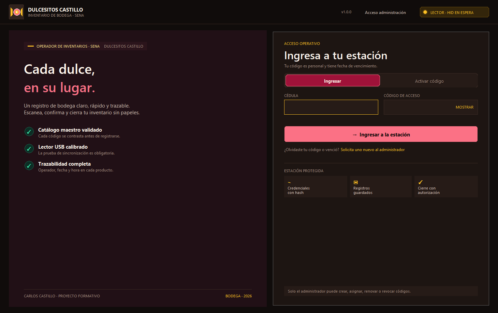
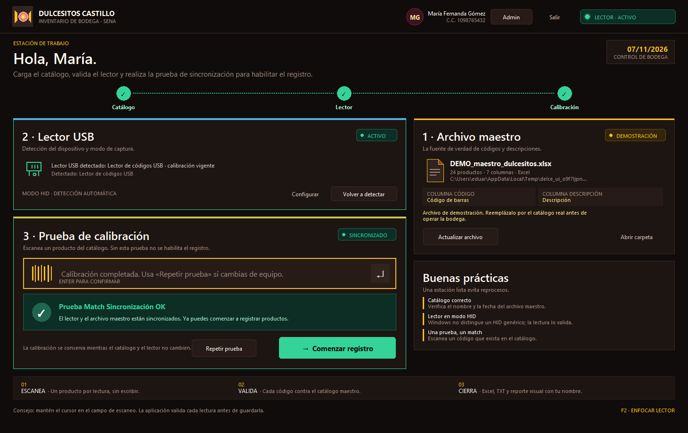
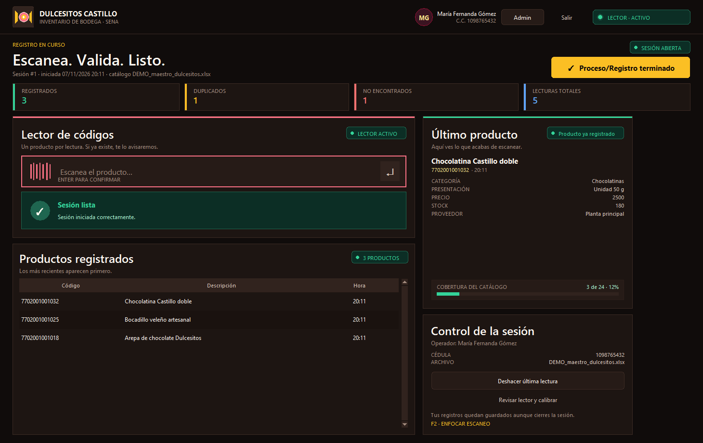
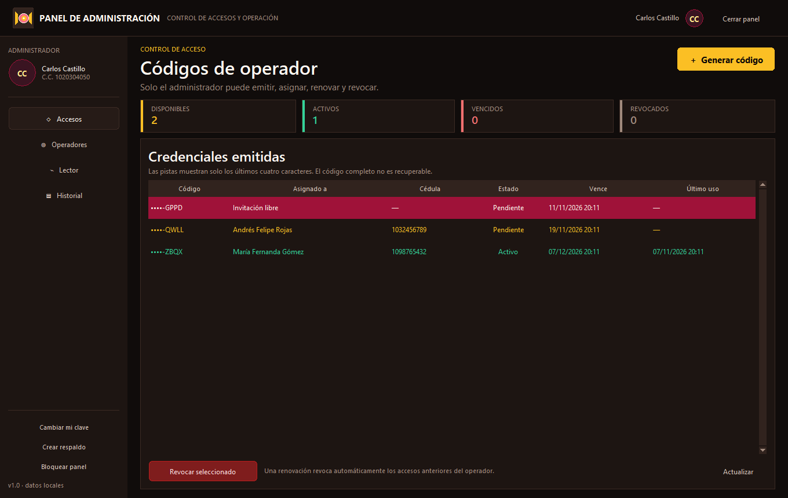
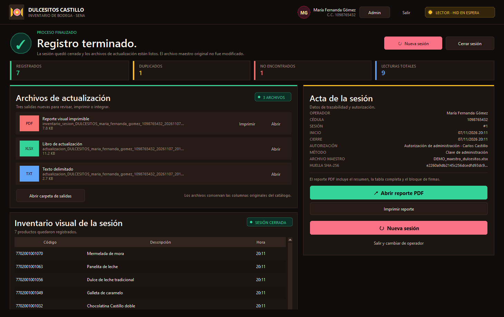

# Dulcesitos_Castillo · Operador de Inventarios

Aplicación de escritorio para **registrar y gestionar el inventario de bodega** de Dulcesitos Castillo (SENA, autor Carlos Castillo). Está pensada para operadores que trabajan de pie, con una mano ocupada y un lector USB de código de barras.

> **Elección tecnológica (una línea):** Python + Tkinter permite una aplicación Windows autocontenida, sin servidor ni navegador, con acceso nativo al teclado HID/puerto serie, almacenamiento SQLite local y exportación a Excel, PDF y TXT mediante bibliotecas maduras.



## Lo que resuelve

- Ingreso de operadores con **cédula + código de acceso** emitido por el administrador.
- Códigos administrados con **fecha de vencimiento y revocación inmediata**; nunca se muestran de nuevo después de crearlos.
- Lectura del **archivo maestro** desde `C:\dulcesito_castillo` (Excel, CSV, TXT, TSV o PDF tabular).
- Detección y estado visible del **lector USB**, con calibración obligatoria.
- Registro de productos con validación contra el catálogo, **fecha, hora y operador**.
- Manejo claro de **duplicados**, **no encontrados** y lecturas deshechas.
- Cierre con dos salidas: **reporte visual imprimible en PDF** y **archivo de actualización** en Excel y TXT.
- Sesiones persistentes: si el operador cierra sesión o la aplicación termina inesperadamente, sus registros ya están guardados y puede reanudar el trabajo.
- Panel administrativo separado, con su propia clave, historial, respaldos y configuración del lector.

## Capturas

| Estación de trabajo | Registro de productos |
| --- | --- |
|  |  |

| Panel administrativo | Cierre y archivos |
| --- | --- |
|  |  |

## Requisitos

- Windows 10 u 11 (probado en Windows 10 de 64 bits).
- Python **3.10 o superior** (probado con Python 3.13).
- Tkinter, incluido normalmente con Python para Windows.
- Un lector de código de barras USB en modo **HID (teclado)** o conectado por **puerto serie COM**.
- Permisos de escritura sobre `C:\dulcesito_castillo` y sobre el perfil del usuario.

Dependencias de ejecución (ver [`requirements.txt`](requirements.txt)):

```text
openpyxl    lectura/escritura de Excel
reportlab   reporte PDF de alto impacto
pdfplumber  lectura de tablas en PDF
pyserial    lectura de lectores por puerto serie
xlrd        lectura de archivos .xls antiguos
```

## Instalación y ejecución en Windows

### Opción A: código fuente (recomendada para desarrollo)

1. Instala Python 3.10+ y marca **Add python.exe to PATH**.
2. Abre la carpeta del proyecto.
3. Haz doble clic en **`instalar.bat`** la primera vez.
4. Haz doble clic en **`ejecutar.bat`**.

`instalar.bat` crea un entorno virtual `.venv` local e instala las dependencias. `ejecutar.bat` abre la aplicación sin consola. Para diagnóstico, usa `ejecutar_consola.bat`.

También puedes hacerlo manualmente:

```bat
python -m venv .venv
.venv\Scripts\python.exe -m pip install -r requirements.txt
.venv\Scripts\python.exe app.py
```

### Opción B: ejecutable autocontenido

```bat
construir_exe.bat
```

El resultado queda en:

```text
dist\DulcesitosCastillo\DulcesitosCastillo.exe
```

Distribuye **toda la carpeta** `dist\DulcesitosCastillo`, no solo el `.exe`. El ejecutable no necesita Python instalado en el equipo de destino.

### Catálogo de demostración

El repositorio incluye un catálogo de ejemplo en [`datos_ejemplo/DEMO_maestro_dulcesitos.xlsx`](datos_ejemplo/DEMO_maestro_dulcesitos.xlsx). Para probar sin cargar datos reales:

1. Ejecuta **`instalar_demo.bat`**.
2. El archivo se copia a `C:\dulcesito_castillo`.
3. La aplicación lo marcará con la etiqueta **DEMOSTRACIÓN**.
4. Reemplázalo por el catálogo real antes de operar la bodega.

## Primer administrador (solo una vez)

1. Abre la aplicación por primera vez.
2. Aparecerá **Configuración única · Paso 0**.
3. Escribe nombre completo, cédula, correo, una clave de administración y su confirmación.
   - Mínimo 10 caracteres, con al menos una letra y un número.
   - No se permiten espacios.
4. Pulsa **Crear administrador**.

No hay credenciales por defecto ni recuperación automática. La clave solo se guarda con **PBKDF2-HMAC-SHA256 + sal aleatoria**. Guárdala en un lugar seguro o en un gestor de contraseñas.

### Emitir el primer código de operador

1. En la barra superior pulsa **Admin** (o **Acceso administración** en la pantalla de ingreso).
2. Ingresa la cédula y la clave del administrador.
3. En **Accesos**, pulsa **Generar código**.
4. Elige:
   - **Invitación libre:** el operador completa sus datos al activar.
   - **Invitación asignada:** el administrador fija nombre, cédula y correo.
   - **Renovar operador:** emite un nuevo acceso y revoca los anteriores.
5. Define la vigencia en días y pulsa **Generar código seguro**.
6. **Copia el código en ese momento.** Por seguridad solo se almacena su hash; no se puede volver a mostrar.

## Calibración del lector (procedimiento)

1. Conecta el lector USB.
2. Copia el archivo maestro real a `C:\dulcesito_castillo`.
3. Inicia sesión como operador.
4. En la estación verifica:
   - **Archivo maestro:** debe aparecer el nombre, número de productos y columnas de código/descripción.
   - **Lector USB:** debe estar **CONECTADO** o **HID EN ESPERA**. Un modelo reconocido se identifica por nombre; un HID genérico se valida con la primera lectura.
5. Escanea un producto que exista en el catálogo.
6. Si el código coincide, verás el aviso verde **«Prueba Match Sincronización OK»**.
7. Solo entonces se habilita **Comenzar registro**.

Si no aparece el aviso:

- Verifica que el producto escaneado esté en el archivo maestro.
- Confirma que el lector envía **Enter** al final de cada lectura.
- Pulsa **Volver a detectar** o revisa el modo en **Admin → Lector**.
- Si usas puerto serie, selecciona el COM correcto y la velocidad configurada en el lector (por defecto 9600 bps).
- Un PDF escaneado como imagen no se puede leer sin OCR; expórtalo a Excel o CSV.

### Configuración del lector

**Admin → Lector** permite elegir:

- **USB HID:** no requiere controladores. Es el modo más común (el lector "escribe" el código y envía Enter).
- **Puerto serie:** selecciona el puerto COM y la velocidad. El lector debe enviar CR/LF al finalizar cada lectura.

Windows no distingue de forma fiable un lector HID genérico de un teclado normal. Por eso el estado inicial puede ser **HID EN ESPERA**; la lectura real y la calibración confirman el dispositivo.

## Flujo del operador

1. Escanea un código en el campo grande de la estación.
2. Registra productos uno a uno:
   - **Verde:** producto registrado.
   - **Ámbar:** producto duplicado; no se agrega de nuevo.
   - **Rojo:** código no encontrado; queda como incidencia, no suma al inventario.
3. Consulta el detalle del producto, la cobertura del catálogo y la tabla de registros.
4. Usa **Deshacer última lectura** si necesitas corregir un error.
5. Pulsa **Proceso/Registro terminado**.
6. Escribe el nombre del operador y la clave de autorización (tu código vigente o la clave del administrador).
7. Se generan los archivos y se muestra el **inventario visual de la sesión**.

### Duplicados y no encontrados

- Cada producto se registra **una sola vez por sesión**.
- Los duplicados se informan y quedan en la bitácora, pero no duplican el inventario.
- Los códigos no encontrados también quedan registrados como incidencia para auditoría.
- Todo registro se guarda en SQLite inmediatamente; un cierre inesperado no pierde el trabajo.

## Archivos generados

Al finalizar se crean archivos nuevos en:

```text
C:\dulcesito_castillo\salidas\
```

Ejemplo de nombres:

```text
actualizacion_DULCESITOS_maria_fernanda_gomez_1098765432_20261107_194650.xlsx
actualizacion_DULCESITOS_maria_fernanda_gomez_1098765432_20261107_194650.txt
inventario_sesion_DULCESITOS_maria_fernanda_gomez_1098765432_20261107_194650.pdf
```

- **XLSX:** hoja `Actualización` con todo el catálogo original + auditoría de la sesión; hoja `Registros de sesión`; hoja `Resumen`.
- **TXT:** tabla delimitada por tabulaciones (UTF-8 con BOM) con las columnas originales + auditoría.
- **PDF:** reporte visual imprimible con resumen, detalle de productos, sello de integridad y firmas.
- El **archivo maestro original nunca se modifica**.

La sesión queda cerrada al finalizar. Desde la pantalla de cierre puedes **abrir el PDF**, **imprimirlo**, **abrir la carpeta**, **iniciar una nueva sesión** o **cambiar de operador**.

## Formato esperado del archivo maestro

La aplicación documenta y aplica estos supuestos:

1. El archivo debe estar en `C:\dulcesito_castillo`. Si hay varios, se usa el más reciente. La carpeta `salidas` no se inspecciona.
2. Formatos admitidos: `.xlsx`, `.xlsm`, `.xls`, `.csv`, `.txt`, `.tsv` y `.pdf` con tablas.
3. Debe existir una fila de encabezados (se buscan las primeras 20 filas) con una **columna de código** y una **columna de descripción**. Se aceptan nombres como:
   - Código: `Código de barras`, `Código`, `Barcode`, `EAN`, `UPC`, `SKU`, `Referencia`, `Código producto`.
   - Descripción: `Descripción`, `Nombre del producto`, `Producto`, `Detalle`, `Description`.
4. Todas las demás columnas se conservan, en su orden original.
5. Los códigos se interpretan como **texto**. Para conservar ceros a la izquierda, la celda de Excel debe estar formateada como texto.
6. Si hay códigos duplicados en el maestro, se usa la primera fila y se muestra una advertencia.
7. En TXT/CSV se detecta automáticamente el delimitador (coma, punto y coma, tabulación o barra vertical) y la codificación (UTF-8 o Windows-1252).
8. En PDF se necesitan tablas extraíbles o texto con columnas separadas. Un PDF escaneado como imagen requiere OCR externo.
9. El tamaño máximo de archivo es de 40 MB.
10. Los valores que comienzan con `=`, `+` o `@` se neutralizan en las exportaciones para evitar fórmulas no deseadas.

Formatos de salida y columnas de auditoría:

```text
REGISTRADO EN SESIÓN · FECHA Y HORA REGISTRO · OPERADOR REGISTRO ·
CÉDULA OPERADOR · ID SESIÓN
```

## Datos locales y respaldo

| Qué | Dónde |
| --- | --- |
| Archivo maestro y salidas | `C:\dulcesito_castillo` y `C:\dulcesito_castillo\salidas` |
| Base local, copias de sesión, logs y respaldos | `%LOCALAPPDATA%\DulcesitosCastillo` |
| Base de datos | `%LOCALAPPDATA%\DulcesitosCastillo\inventario.db` |
| Copias del catálogo por sesión | `%LOCALAPPDATA%\DulcesitosCastillo\sesiones` |
| Logs | `%LOCALAPPDATA%\DulcesitosCastillo\logs\aplicacion.log` |

**Crear un respaldo:** Admin → **Crear respaldo**. Se guarda una copia consistente en `%LOCALAPPDATA%\DulcesitosCastillo\respaldos`.

**Restaurar:** cierra la aplicación, reemplaza `inventario.db` por el respaldo y vuelve a abrir.

Las rutas de datos se pueden aislar con las variables de entorno:

```text
DULCESITOS_MAESTRO_DIR
DULCESITOS_DATA_DIR
DULCESITOS_SIN_SONIDO=1
```

## Seguridad

- Las claves de administración y los códigos de acceso se guardan con **PBKDF2-HMAC-SHA256** (480 000 iteraciones, sal aleatoria de 16 bytes) y comparación en tiempo constante.
- Los códigos de acceso tienen **60 bits de entropía** y formato legible `DLC-XXXX-XXXX-XXXX`.
- El código completo se muestra **una sola vez** al administrador. Después solo se conserva su hash y una pista de los últimos cuatro caracteres.
- El panel administrativo se abre con una credencial independiente de las de operador.
- Las sesiones y lecturas se guardan con el operador, la fecha/hora y el catálogo de origen (hash SHA-256 + copia de seguridad).
- La base de datos no contiene claves ni códigos en texto plano.
- La aplicación no envía datos a Internet. La única consulta externa es local: PowerShell enumera dispositivos USB/COM del equipo.
- Si se pierde la clave de administración, **no existe recuperación automática**. Restaura un respaldo o reinstala la base de datos solo si aceptas perder los datos actuales.

## Estructura del proyecto

```text
Dulcesitos_Castillo/
├── app.py                          Punto de entrada
├── ejecutar.bat                    Lanzador para Windows
├── instalar.bat                    Creación del entorno virtual
├── ejecutar_consola.bat            Lanzador con diagnóstico
├── diagnostico.bat                 Autodiagnóstico de dependencias
├── instalar_demo.bat               Copia el catálogo de ejemplo
├── construir_exe.bat               Empaquetado con PyInstaller
├── DulcesitosCastillo.spec         Configuración de PyInstaller
├── requirements.txt
├── requirements-dev.txt
├── pyproject.toml
├── README.md
├── LICENSE
├── assets/
│   ├── icono.ico
│   └── logo.png
├── datos_ejemplo/
│   ├── DEMO_maestro_dulcesitos.xlsx
│   └── DEMO_maestro_dulcesitos.csv
├── docs/
│   ├── GUIA_RAPIDA.md
│   └── capturas/
├── dulcesitos/
│   ├── config.py                   Rutas y DPI
│   ├── seguridad.py                Hashing y códigos
│   ├── base_datos.py               SQLite y transacciones
│   ├── archivo_maestro.py          Lectura Excel/CSV/TXT/PDF
│   ├── lector.py                   Monitor HID/serie
│   ├── servicios.py                Autenticación e inventario
│   ├── exportacion.py              XLSX, TXT y PDF
│   ├── modelos.py                  Modelos de dominio
│   ├── utilidades.py               Fechas, validaciones y archivos
│   └── ui/
│       ├── aplicacion.py           Ventana principal y navegación
│       ├── pantalla_acceso.py      Primer arranque e ingreso
│       ├── pantalla_estacion.py    Catálogo, lector y calibración
│       ├── pantalla_registro.py    Escaneo y tabla de sesión
│       ├── pantalla_cierre.py      Inventario visual y salidas
│       ├── panel_admin.py          Administración de accesos
│       ├── dialogos.py             Modales de autorización y códigos
│       ├── componentes.py          Widgets dibujados
│       ├── tema.py                 Paleta y tipografía
│       └── sonido.py               Feedback sonoro
├── herramientas/                   Utilidades de desarrollo y capturas
├── pruebas/                        Pruebas automatizadas
└── .github/workflows/pruebas.yml   Integración continua
```

## Pruebas automatizadas

```bat
.venv\Scripts\python.exe -m pytest
```

La suite cubre seguridad, lectura de archivos maestro (Excel, CSV, TXT y PDF), sesiones, duplicados, renovación/revocación, autorización y generación de los tres archivos de salida. También hay una prueba de humo visual:

```bat
.venv\Scripts\python.exe herramientas\prueba_ui.py
```

## Diagnóstico técnico

Para revisar dependencias, permisos y la capacidad de generar archivos:

```bat
diagnostico.bat
```

Cuando existe el ejecutable compilado, el script ejecuta:

```bat
dist\DulcesitosCastillo\DulcesitosCastillo.exe --diagnostico
```

El informe se guarda en `%LOCALAPPDATA%\DulcesitosCastillo\diagnostico.txt` y comprueba Tkinter, Excel, PDF, PDF tabular, SQLite, el archivo maestro y la detección de PowerShell/puertos COM.

## Solución de problemas

| Síntoma | Qué revisar |
| --- | --- |
| No se puede crear `C:\dulcesito_castillo` | Ejecuta la instalación con una cuenta con permisos sobre `C:\` o pide al administrador del equipo que habilite la escritura. |
| El archivo maestro no aparece | Debe estar directamente en `C:\dulcesito_castillo`, con extensión admitida y no ser un archivo temporal `~$`. |
| «No se encontró una tabla de productos» | La fila de encabezados debe tener columnas de código y descripción. Revisa los nombres admitidos. |
| El lector no pasa de HID EN ESPERA | Haz una lectura; Windows no identifica modelos genéricos. Revisa que el lector envíe Enter. |
| El puerto COM no aparece | Revisa el cable, instala el controlador del fabricante y pulsa **Redetectar**. |
| El código venció o fue revocado | El administrador debe emitir una renovación desde **Accesos → Generar código**. |
| Error al generar el PDF | Cierra el archivo si está abierto en otro programa y verifica permisos de la carpeta `salidas`. |
| El operador cerró sesión por error | Al volver a ingresar se ofrece **Reanudar registro** con los datos guardados. |
| Clave de administración perdida | No hay recuperación automática; restaura un respaldo de `%LOCALAPPDATA%\DulcesitosCastillo\inventario.db`. |

Los detalles técnicos quedan en `%LOCALAPPDATA%\DulcesitosCastillo\logs\aplicacion.log`.

## Limitaciones conocidas

- Windows no expone una identificación universal de lectores HID genéricos. La **lectura real + calibración** es la validación definitiva.
- No se implementa OCR para PDF escaneados.
- La aplicación está optimizada para un equipo de bodega con un operador a la vez; varias instancias pueden compartir archivos, pero no está pensada para edición concurrente del mismo catálogo.
- El panel administrativo está protegido por clave al abrirse. El botón **Bloquear panel** permite cerrarlo de inmediato.
- La aplicación no se sincroniza en la nube.

## Autoría y licencia

Proyecto formativo **Dulcesitos_Castillo** · SENA · Autor: **Carlos Castillo**.

Distribuido bajo licencia [MIT](LICENSE). El catálogo de demostración y los nombres de productos son ficticios y se incluyen solo para probar la aplicación.

Repositorio: <https://github.com/MrCastilloF/Dulcesitos_Castillo>
